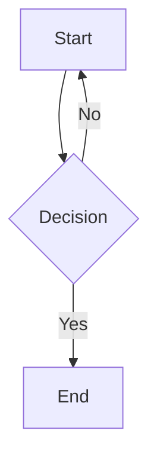

# MarkView.Avalonia

[](https://www.nuget.org/packages/MarkView.Avalonia)
[](https://www.nuget.org/packages/MarkView.Avalonia)
[](https://avaloniaui.net)
[](LICENSE.md)
[](https://github.com/Kryptos-FR/MarkView.Avalonia/actions/workflows/ci.yml)


A [Markdig](https://github.com/xoofx/markdig)-powered markdown viewer control for [Avalonia UI](https://avaloniaui.net) v12. Drop `MarkdownViewer` into any Avalonia window or panel to render rich markdown — headings, code blocks, tables, task lists, links, images, and more — using native Avalonia controls with a fully customisable theme.

## Installation

```bash
dotnet add package MarkView.Avalonia
```

## Quick Start

Include the default theme and add `MarkdownViewer` to your XAML:

```xml
<Window xmlns="https://github.com/avaloniaui"
        xmlns:x="http://schemas.microsoft.com/winfx/2006/xaml"
        xmlns:mv="using:MarkView.Avalonia">
  <Window.Styles>
    <StyleInclude Source="avares://MarkView.Avalonia/Themes/MarkdownTheme.axaml" />
  </Window.Styles>

  <mv:MarkdownViewer Markdown="# Hello, MarkView!" />
</Window>
```

### Setting a base URI for relative links and images

```csharp
viewer.BaseUri = new Uri("https://raw.githubusercontent.com/Kryptos-FR/MarkView.Avalonia/main/");
viewer.Markdown = markdownText; // relative image paths resolved against BaseUri
```

### Handling link clicks

External links open automatically via the platform's launcher (OS browser on desktop,
an intent on mobile, a new tab on WebAssembly) — no code required. `LinkClicked` is an
Avalonia **routed event** (bubbles up), raised before that default launch happens;
subscribe to override it for specific links by setting `e.Handled = true`:

```csharp
viewer.LinkClicked += (_, e) =>
{
    // e.Url contains the clicked URL
    if (e.Url.EndsWith(".md"))
    {
        viewer.Source = new Uri(e.Url); // render in-place instead of opening externally
        e.Handled = true;
    }
};
```

`LinkClickedEvent` is an Avalonia **routed event** (bubbles up) — subscribe globally once at app startup to handle all viewers:

```csharp
// App.axaml.cs — applies to every MarkdownViewer in the application
MarkdownViewer.LinkClickedEvent.AddClassHandler<MarkdownViewer>((_, e) =>
{
    // ...
});
```

### Interactive task lists

Set `AreTaskListsInteractive` to make `- [ ]` / `- [x]` items clickable (off by default, so
read-only viewers keep the static ☐/☑ glyph). The viewer only toggles the checkbox; it never edits
its own markdown — handle `TaskToggled` to write the change back to your source:

```csharp
viewer.AreTaskListsInteractive = true;
viewer.TaskToggled += (_, e) =>
{
    // e.SourceStart / e.SourceLength locate the "[ ]" or "[x]" marker in viewer.Markdown
    var source = viewer.Markdown!;
    viewer.Markdown = string.Concat(
        source.AsSpan(0, e.SourceStart),
        e.IsChecked ? "[x]" : "[ ]",
        source.AsSpan(e.SourceStart + e.SourceLength));
};
```

See [Interactive task lists](docs/configuration.md#interactive-task-lists) for details.

### Navigating to an anchor

```csharp
viewer.ScrollToAnchor("my-heading");  // scrolls to the heading's anchor position
```

### Code block toolbar

Code blocks show their language and a copy button above the code, and display formulas
(`MarkView.Avalonia.Math`) a copy button for their TeX source in their top right corner. Turn
either off per viewer or for the whole application with a style, or show the copy buttons only
while the pointer is over their block:

```xml
<mv:MarkdownViewer ShowCodeBlockLanguage="False" ShowCodeBlockCopyButton="False" />
<mv:MarkdownViewer ShowCodeBlockCopyButtonOnHover="True" />
```

Line numbers, wrapping long lines, and a maximum height past which a block scrolls inside itself
are opt-in:

```xml
<mv:MarkdownViewer ShowCodeBlockLineNumbers="True" WrapCodeBlockLines="True" CodeBlockMaxHeight="400" />
```

See [Code block toolbar](docs/configuration.md#code-block-toolbar) for details.

### Right-to-left text

Each paragraph, heading, list, quote and table takes the direction of its own text, so Hebrew and
Arabic read right to left and code stays left to right. Turn detection off to use the viewer's
`FlowDirection` for the whole document:

```xml
<mv:MarkdownViewer DetectTextDirection="False" />
```

See [Right-to-left text](docs/right-to-left.md) for details, including the fonts a browser build
needs.

### Custom fenced blocks

Render the fenced code blocks of a language as your own control, without writing a Markdig
renderer. The factory gets the block's content and its info string:

```csharp
viewer.UseFenceRenderer("chart", (code, info) => new MyChart(code));   // ```chart blocks
```

See [Custom fenced blocks](docs/configuration.md#custom-fenced-blocks) for details.

### Using a custom Markdig pipeline

```csharp
viewer.Pipeline = new MarkdownPipelineBuilder()
    .UseGitHubExtensions()      // the viewer's default pipeline
    .UseAbbreviations()
    .UseFigures()
    .Build();
```

## Extension Methods

Convenience methods configure a pipeline with a single opt-in feature:

```csharp
viewer.UseAbbreviations();
viewer.UseAlertBlocks();
viewer.UseCitations();
viewer.UseFigures();
viewer.UseFootnotes();
viewer.UseHardlineBreaks();
viewer.UseMediaLinks();
```

To combine several opt-in features, build the pipeline explicitly (see above).

## Application-Wide Defaults

`MarkdownViewerDefaults` lets you set a pipeline and/or extensions once so that every `MarkdownViewer` in the application inherits them automatically — no need to configure each instance:

```csharp
// App.axaml.cs
MarkdownViewerDefaults.Pipeline = new MarkdownPipelineBuilder()
    .UseGitHubExtensions()
    .UseExtendedAlertBlocks()
    .Build();

MarkdownViewerDefaults.Extensions.AddTextMateHighlighting();
MarkdownViewerDefaults.Extensions.AddSvg();
MarkdownViewerDefaults.Extensions.AddMermaid();
MarkdownViewerDefaults.Extensions.AddFenceRenderer("chart", (code, info) => new MyChart(code));
```

Per-instance `Pipeline` and `Extensions` take precedence over the defaults; an extension object shared between the defaults list and an instance list is only registered once per render.

## Supported Markdown Features

### CommonMark baseline (always on)

| Feature | Notes |
|---------|-------|
| Headings H1–H6 | CommonMark |
| Bold, italic | CommonMark |
| Inline code | CommonMark |
| Fenced code blocks | CommonMark; any language can render as your own control ([custom fenced blocks](#custom-fenced-blocks)) |
| Blockquotes | CommonMark |
| Ordered and unordered lists | CommonMark, tight and loose |
| Links and autolinks | CommonMark + extension |
| Images | CommonMark, remote URLs loaded async and cached in memory ([image cache](docs/configuration.md#image-cache)) |
| Image sizing | `` — inline pixel dimensions, e.g. `=80x80` |
| Image zoom | Clicking an image or a Mermaid diagram opens it in a lightbox over the viewer, with zoom and pan (`IsImageZoomEnabled`, on by default) |
| Broken images | An image that fails to load shows a placeholder with its alt text |
| Thematic breaks | CommonMark |
| Hard line breaks | CommonMark (`\` or two spaces) |
| HTML `<br>` / `<br />` | Rendered as line break |
| Right-to-left text | Each block takes the direction of its first letter that has one (Hebrew, Arabic…); code stays left to right ([right-to-left text](docs/right-to-left.md)) |

### Extensions (enabled by default, with `UseGitHubExtensions()`)

| Feature | Syntax |
|---------|--------|
| Strikethrough | `~~text~~` or `~text~`, as on GitHub |
| Task lists | `- [x] item` (clickable with `AreTaskListsInteractive`) |
| Pipe tables | GFM-style `\| col \| col \|` |
| Autolinks | bare `https://…` URLs |
| Emoji shortcodes | `:rocket:` → 🚀 (ASCII smileys like `:)` are intentionally left as plain text) |
| GitHub alert blocks | `> [!NOTE]` etc. |
| Footnotes | `[^1]` |
| CJK-friendly emphasis | parser-only fix for emphasis next to Chinese/Japanese/Korean (CJK) punctuation |
| YAML front matter | `---` metadata block at the top of a document is parsed and hidden |
| Collapsible details | HTML `<details>` / `<summary>`, as on GitHub (also `UseHtmlDetails()` on its own) |
| HTML subset | The HTML READMEs use, with native controls: `<p align="center">` / `<div align>` headers, `<a></a>` badges, `<kbd>`, `<sub>`, `<sup>`, `<mark>`, `<b>`, `<code>`, `<hr>`… Nothing runs; only `` sources are fetched (also `UseHtmlSubset()` on its own; see [HTML subset](docs/configuration.md#html-subset)) |

`UseSupportedExtensions()`, the previous default, enables the same features except alerts, footnotes and details, and adds subscript (`~text~`), superscript (`^text^`), underline (`++text++`), highlight (`==text==`) and grid tables.

**Subscript is not available on top of `UseGitHubExtensions()`:** there `~text~` is always strikethrough, as on GitHub, even with `UseEmphasisExtras()`. For subscript, build the pipeline from `UseSupportedExtensions()` and add `UseAlertBlocks()` / `UseFootnotes()` if needed. See [Markdig Pipeline](docs/configuration.md#markdig-pipeline).

### Opt-in extensions

These require adding `.UseXxx()` to the pipeline (see [Extension Methods](#extension-methods) above):

| Feature | Activation | Syntax |
|---------|-----------|--------|
| Abbreviations | `UseAbbreviations()` | `*[HTML]: …` |
| Foldable alerts and custom titles | `UseExtendedAlertBlocks()` (also enabled by `viewer.UseAlertBlocks()`) | Obsidian-style `> [!NOTE] Custom title`, foldable `> [!NOTE]-` (collapsed) / `> [!NOTE]+` (expanded) |
| Superscript, underline, highlight | `UseEmphasisExtras()` | `^text^`, `++text++`, `==text==` |
| Grid tables | `UseGridTables()` | RST-style grid tables |
| Citations | `UseCitations()` | `""quoted text""` |
| Figures | `UseFigures()` | `^^^` / `^^^ caption` |
| Hardline breaks | `UseHardlineBreaks()` | every soft line break renders as a hard break |
| Thinking blocks | `UseThinkingBlocks()` (also `viewer.UseThinkingBlocks()`) | a reasoning model's `<think>…</think>` folded away under "Thinking…" / "Thought for 12 seconds" (see [Thinking blocks](docs/configuration.md#thinking-blocks)) |
| YouTube embeds | `UseMediaLinks()` | `` |
| Definition lists | `UseDefinitionLists()` | `Term` followed by `:   definition` |
| Custom containers | `UseCustomContainers()` | `:::name` … `:::` blocks, `::text::` inline |
| Footers | `UseFooters()` | `^^ footer text` |
| Smart punctuation | `UseSmartyPants()` | `"quotes"`, `--`, `---`, `...`, `<<…>>` become “ ” – — … « » |
| Letter and roman numeral lists | `UseListExtras()` | `a.`, `A.`, `i.`, `I.` |
| Style classes from attributes | `UseGenericAttributes()` (call it last) | `{.name}` adds `name` to the element's style classes |

The last six are Markdig's own pipeline methods; MarkView.Avalonia renders what they parse.

## Extension Packages

MarkView.Avalonia ships optional NuGet packages that add richer rendering capabilities. Each package implements `IMarkViewExtension` and is activated via a convenience method on `MarkdownViewer`, or globally via `MarkdownViewerDefaults.Extensions.AddXxx()`.

### Syntax Highlighting (`MarkView.Avalonia.SyntaxHighlighting`)

Adds TextMate grammar-based syntax highlighting to fenced code blocks.

```bash
dotnet add package MarkView.Avalonia.SyntaxHighlighting
```

```csharp
viewer.UseTextMateHighlighting(); // DarkPlus / LightPlus by default
// or with custom themes:
viewer.UseTextMateHighlighting(darkTheme: ThemeName.Monokai, lightTheme: ThemeName.QuietLight);
```

The extension replaces the built-in `CodeBlockRenderer` with `TextMateCodeBlockRenderer`, which tokenises each line and emits coloured `Run` elements. Unsupported languages fall back to the default monochrome rendering automatically.

Colours update in-place when the user switches between light and dark themes — no document rebuild or scroll reset.

Available `ThemeName` values are defined by TextMateSharp.Grammars: `DarkPlus`, `LightPlus`, `Monokai`, `SolarizedDark`, `SolarizedLight`, and more.

### SVG Images (`MarkView.Avalonia.Svg`)

Renders SVG images embedded in markdown (``), including `data:image/svg+xml` data URIs and badge-service URLs that return SVG without a `.svg` extension.

```bash
dotnet add package MarkView.Avalonia.Svg
```

```csharp
viewer.UseSvg();
```

The extension inserts `SvgImageLoader` at the front of the image loader chain. Regular raster images continue to load via the built-in HTTP fallback.

### LaTeX Math (`MarkView.Avalonia.Math`)

Renders `$...$` and `\(...\)` (inline) and `$$...$$` and `\[...\]` (display) LaTeX math using CSharpMath's SkiaSharp renderer — pure .NET, no browser or WebView required. The bracket delimiters, which LLMs commonly emit, can be turned off with `viewer.UseMath(bracketDelimiters: false)`.

```bash
dotnet add package MarkView.Avalonia.Math
```

```csharp
viewer.UseMath();
```

### Mermaid Diagrams (`MarkView.Avalonia.Mermaid`)

Renders fenced `mermaid` code blocks as SVG diagrams using the [Mermaider](https://github.com/nullean/mermaider) library (pure .NET, no browser required). Works on all platforms including Linux. Diagrams re-render automatically when the user switches between light and dark themes. Clicking a diagram opens it in the viewer's lightbox, where it can be zoomed and panned.

```bash
dotnet add package MarkView.Avalonia.Mermaid
```

```csharp
viewer.UseMermaid();
```

Markdown syntax:

````markdown

````

### Combining extensions

All four can be stacked:

```csharp
viewer
    .UseTextMateHighlighting()
    .UseSvg()
    .UseMermaid()
    .UseMath();
```

Extensions are applied in the order they are added to `viewer.Extensions`. Each extension's `Register` method is called once per render pass, before the Markdig pipeline is set up.

### Writing your own extension

Implement `IMarkViewExtension` from the core package:

```csharp
using MarkView.Avalonia.Extensions;
using MarkView.Avalonia.Rendering;

public class MyExtension : IMarkViewExtension
{
    public void Register(AvaloniaRenderer renderer)
    {
        // swap a renderer, add an image loader, or set a code highlighter
        renderer.ObjectRenderers.ReplaceOrAdd<CodeBlockRenderer>(new MyCodeBlockRenderer());
    }
}

viewer.Extensions.Add(new MyExtension());
```

## Theming / Customisation

Include `MarkdownTheme.axaml` for default styles. For a document that looks like Markdown on github.com (GitHub's fonts, spacing and Primer colours, in light and dark, with every colour meeting WCAG AA contrast), also include the **GitHub theme preset** after it:

```xml
<StyleInclude Source="avares://MarkView.Avalonia/Themes/MarkdownTheme.axaml" />
<StyleInclude Source="avares://MarkView.Avalonia/Themes/GitHubTheme.axaml" />
```

For chat messages, include the **Chat theme preset** (`ChatTheme.axaml`) instead: compact spacing, small headings and code cards, on whatever bubble, font and text colour the host gives the viewer. For documentation pages, the **Docs theme preset** (`DocsTheme.axaml`) gives the look of a VitePress site: a centred reading column, airy spacing and tinted alerts.

See [Theme presets](docs/theming.md#theme-presets) for what each preset changes, and [Colour resources](docs/theming.md#colour-resources) for every colour key you can redefine.

Override any style class in your own `Styles` to customise appearance:

| Style class | Applied to | Controls |
|-------------|------------|----------|
| `markdown-h1` … `markdown-h6` | Headings | `TextBlock` |
| `markdown-heading-foldable` | Heading with a fold button (`AreHeadingsFoldable`; `:expanded` while open) | `TextBlock` |
| `markdown-heading-fold` | Fold button of a heading | `Control` |
| `markdown-paragraph` | Paragraphs | `TextBlock` |
| `markdown-code-block` | Code blocks | `Border` |
| `markdown-code-container` | Code block with its toolbar | `StackPanel` |
| `markdown-code-header` | Code block toolbar | `Border` |
| `markdown-code-language` | Code block language label | `TextBlock` |
| `markdown-code-copy` | Code block and display formula copy button | `Button` |
| `markdown-code-line-numbers` | Code block line numbers | `TextBlock` |
| `markdown-code-scroll` | Scrolls a code block taller than `CodeBlockMaxHeight` | `ScrollViewer` |
| `markdown-custom-fence` | Control a fence renderer returned (`UseFenceRenderer`) | `Border` |
| `markdown-fence-<language>` | The same, by fence language in lower case | `Border` |
| `markdown-code-inline` | Inline code | `Border` |
| `markdown-blockquote` | Blockquotes | `Border` |
| `markdown-list` | Lists | `StackPanel` |
| `markdown-list-marker` | List item bullet, number or task-list glyph | `TextBlock` |
| `markdown-task-list` | Task-list check glyph (☐/☑) | `TextBlock` |
| `markdown-task-toggle` | Clickable task-list checkbox (`AreTaskListsInteractive`) | `ToggleButton` |
| `markdown-thematic-break` | Horizontal rules | `Separator` |
| `markdown-image` | Images | `Image` |
| `markdown-image-failed` | Placeholder of an image that could not be loaded | `Border` |
| `markdown-image-lightbox` | Lightbox a clicked image opens in (`IsImageZoomEnabled`) | `Panel` |
| `markdown-link` | Hyperlinks | `HyperlinkButton` |
| `markdown-table` | Tables | `Grid` |
| `markdown-table-cell` | Table cells | `Border` |
| `markdown-table-header` | Header cells | `Border` |
| `markdown-table-row-even` | Cells of every second body row (2nd, 4th, …) | `Border` |
| `markdown-marked` | Highlighted text (`==…==`) | `Span` |
| `markdown-alert` | Alert block container | `Border` |
| `markdown-alert-note` … `markdown-alert-caution` | Per-kind border colour | `Border` |
| `markdown-alert-header` | Alert kind label or custom title | `TextBlock` |
| `markdown-alert-collapsible` | Foldable alert (`:expanded` while open) | `Border` |
| `markdown-alert-chevron` | Fold indicator in a foldable alert's header | `Run` |
| `markdown-thinking` | Language model reasoning (`UseThinkingBlocks`; `:expanded` while open, `:thinking` while it arrives) | `Border` |
| `markdown-thinking-header` | Thinking block title, the fold target | `TextBlock` |
| `markdown-thinking-chevron` | Fold indicator in a thinking block's title | `Control` |
| `markdown-thinking-content` | Reasoning text of a thinking block | `Border` |
| `markdown-figure` | Figure container | `Border` |
| `markdown-figure-caption` | Figure caption | `TextBlock` |
| `markdown-abbr` | Abbreviation with tooltip | `TextBlock` |
| `markdown-footnote-ref` | Footnote reference link | `HyperlinkButton` |
| `markdown-footnote-separator` | Line above the footnotes (also `markdown-thematic-break`) | `Separator` |
| `markdown-footnote-group` | Footnote definition list | `StackPanel` |
| `markdown-footnote-item` | Individual footnote row | `Grid` |
| `markdown-definition-list` | Definition list | `StackPanel` |
| `markdown-definition-term` | Defined term | `TextBlock` |
| `markdown-definition` | Definition (indented) | `StackPanel` |
| `markdown-custom-container` | Custom container (`:::name`, also gets `name` as a class) | `Border` |
| `markdown-custom-container-title` | Custom container title | `TextBlock` |
| `markdown-custom-inline` | Inline custom container (`::text::`) | `Span` |
| `markdown-footer` | Footer (`^^`) | `StackPanel` |

Colours are `DynamicResource` brushes (`MarkdownLinkForeground`, `MarkdownTableBorder`, …) that meet WCAG 2.2 AA contrast, with a high-contrast palette that follows the OS setting; see [Accessibility](docs/accessibility.md).

Extension packages may ship their own theme file with additional overridable colours — check the extension's README for its `StyleInclude` path and resource keys.

Example — increase heading size and add a bottom border:

```xml
<Style Selector="TextBlock.markdown-h1">
  <Setter Property="FontSize" Value="36" />
  <Setter Property="Foreground" Value="#1A1A2E" />
  <Setter Property="Margin" Value="0,12,0,6" />
</Style>
```

## Text Selection

`MarkdownViewer` supports full document-wide text selection:

- **Click + drag** to select a range.
- **`Ctrl+A`** to select all text.
- **`Ctrl+C`** to copy the selection to the clipboard.
- **Right-click** for a context menu: Copy, Copy as Markdown, Copy link (on a link) and Select all.

Programmatic API:

```csharp
viewer.SelectAll();
viewer.ClearSelection();
string text = viewer.SelectedText;
await viewer.CopyToClipboardAsync();

// The selection as Markdown: whole blocks as written, cut blocks rebuilt
string markdown = viewer.GetSelectedMarkdown();
await viewer.CopyAsMarkdownAsync();

// React to the selection, or change what is copied
viewer.SelectionChanged += (_, _) => copyButton.IsEnabled = viewer.HasSelection;
viewer.CopyingToClipboard += (_, e) => e.Text = e.Text.Trim();
```

A selection that spans an image copies the image's alt text in its place; math formulas and Mermaid diagrams copy their source. Copying also writes the selection as HTML, so pasting into a word processor or a chat keeps its formatting. See [Text Selection](docs/text-selection.md) for details.

## Find in Document

`MarkdownViewer` finds text in the rendered document, highlights every match, and scrolls from one
match to the next, expanding collapsed alerts, details blocks and heading sections on the way. It has no find bar of
its own; bind yours to the API:

```csharp
int count = viewer.Find("markdown");                      // case-insensitive by default
viewer.Find("Markdown", MarkdownFindOptions.MatchCase | MarkdownFindOptions.WholeWord);
viewer.FindNext();                                        // or FindPrevious(); wraps around
int current = viewer.CurrentFindMatchIndex;              // with FindMatchCount, bindable
viewer.ClearFind();
```

See [Find in Document](docs/find-in-document.md) for what is searched and the highlight colours.

## Streaming

`MarkdownViewer` can render text as it arrives, such as the answer of a language model. Text appended
to a streaming session is rendered in one update per interval (32 ms by default), and each update
re-renders only the open tail of the document, so the rest keeps its controls, selection and scroll
position. The syntax left open at the end of the text, such as an unmatched `` ` `` or `**`, is closed
between updates so the text renders as it will once complete; pass `healIncompleteSyntax: false` to
`BeginStreaming` to turn it off. Mermaid diagrams and formula blocks render as code until the text
has moved past their block.

```csharp
viewer.Markdown = "";
using var session = viewer.BeginStreaming();   // viewer.AutoScrollToEnd = true follows the end

foreach (var token in tokens)
    session.Append(token);
// leaving the block completes the session; session.Complete() does it explicitly
```

See [Streaming](docs/streaming.md) for completing a session, auto-scroll, what happens to the selection
and search, how incomplete syntax is healed, and how custom renderers can tell that a block contains the end of the text.

## Accessibility

- **Keyboard.** `Tab` / `Shift+Tab` move through the document's links and interactive elements in reading order, with a focus ring, and `Enter` opens the focused link. The arrow keys, `Page Up` / `Page Down`, `Space` and `Home` / `End` scroll the document.
- **Screen readers.** Headings report their level, and lists, tables, quotes, alerts, images and links report their roles.
- **Contrast.** Default colours meet WCAG 2.2 AA, and a high-contrast palette follows the OS setting.

See [Accessibility](docs/accessibility.md).

## Known Limitations

| Limitation | Detail |
|---|---|
| Anchor scroll is instant | `BringIntoView()` jumps without animation. Smooth scrolling is a future improvement. |

## Versioning

All five packages are released together under the same version, `12.MAJOR.MINOR`:

| Part | Meaning |
|---|---|
| `12` | The Avalonia major version the packages are built for. It changes only with Avalonia's, so MarkView for Avalonia 13 will start at 13.0.0. |
| `MAJOR` | Incremented for breaking changes: a removed or renamed API, or a change of behaviour that needs code changes. |
| `MINOR` | Incremented for every other release: new features and fixes. |

NuGet and update tools such as Dependabot read the version as `MAJOR.MINOR.PATCH`, so they treat a breaking release (12.3 → 12.4) as a minor update. To receive only compatible updates, use a floating version that fixes the second number, such as `12.4.*`, rather than `12.*`. The release notes of each breaking release list what changed and how to update.

## License

[MIT](LICENSE.md) © Nicolas Musset
