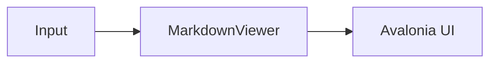

# Images and diagrams

Images load in the background and scale down to the viewer's width. Clicking one can open it in a lightbox, and the SVG and Mermaid packages add vector images and diagrams:

```xml
<mv:MarkdownViewer IsImageZoomEnabled="True" ImageResizeMode="ScaleDownToFit" />
```

```csharp
viewer.UseSvg();       // MarkView.Avalonia.Svg
viewer.UseMermaid();   // MarkView.Avalonia.Mermaid
```

```markdown

```

Relative addresses resolve against `BaseUri` or the folder of `Source` (see [Displaying documents](displaying-documents.md#relative-links-and-images)). Bitmaps (PNG, JPEG, GIF, BMP, WebP…) load from `http` and `https` addresses, embedded resources (`avares://`) and `data:image/…` addresses; a remote response over 64 MB is not loaded. With [lazy rendering](displaying-documents.md#lazy-rendering), an image starts loading when it is about to scroll into view.

## Sizing

`ImageResizeMode` sets how an image without a size hint scales to the viewer's width:

| Mode | Behaviour |
|------|----------|
| `ScaleDownToFit` (default) | Scales down to fit the width; never enlarged past its natural size. |
| `Natural` | Its natural pixel size. A wider image is cut off, since the viewer does not scroll horizontally by default. |
| `Fill` | Always fills the width, enlarging small images. |

```xml
<Style Selector="mv|MarkdownViewer">
  <Setter Property="ImageResizeMode" Value="Fill" />
</Style>
```

`` caps one image at `W`×`H` pixels, whatever the mode: a larger image is scaled down to fit, a smaller one is never enlarged. The `width` and `height` attributes of an HTML `` act the same way, and either can be given alone. In code (code spans and code blocks), a hint is text and shows as written.

`Fill` and `ScaleDownToFit` need a width to scale to, which the template's `ScrollViewer` gives while its horizontal scroll bar is disabled (the default). With `ScrollViewer.HorizontalScrollBarVisibility="Auto"` on the viewer, or a template without `PART_ScrollViewer`, they may behave like `Natural`.

## Images that fail to load

When an image cannot be loaded (no loader accepts its address, the server answers with an error, the data cannot be decoded…), a small placeholder shows in its place: a broken-image icon followed by the alt text, in a muted colour. Selection still copies the alt text. The placeholder is one line high whatever the `=WxH` hint, which only caps it, so a missing picture never leaves a large empty box in the text. Removing an image while it loads (a new render, a closed document) cancels the load.

## Lightbox

With `IsImageZoomEnabled` (off by default), clicking an image opens it in a lightbox over the viewer, as large as fits but never enlarged past its natural size. Mermaid diagrams, drawn as vectors, are enlarged up to twice their size to fit.

- The mouse wheel, a pinch, or the + and − keys zoom, about the pointer, the pinch or the centre; the toolbar at the bottom has zoom out, zoom in and fit buttons and shows the zoom level. The 0 key fits the picture again.
- Dragging or the arrow keys pan a picture larger than the lightbox. The zoom goes from the fitted size to eight times the natural size.
- Clicking outside the picture and the toolbar, the close button, or Escape closes it.
- Zoomable pictures show a zoom-in cursor and are focusable: Enter or Space opens the lightbox, which keeps the focus until it closes, then returns it.
- An image inside a link opens the link instead, and ending a selection drag on an image does not open it.
- The lightbox covers the viewer, not the window, and is part of it, so it works with any template and on every platform. Rendering another document closes it.

## Saving images and diagrams

An image or a diagram can be saved to a file: with the save button of the lightbox, `Ctrl+S` (`Cmd+S` on macOS) in the lightbox, or **Save image as…** in the viewer's [context menu](text-selection.md#context-menu), which works with the lightbox off too. The platform's save picker asks where; in a browser without one (Firefox, Safari), the file is downloaded.

| Picture | Formats | Suggested name |
|---------|---------|----------------|
| Mermaid diagram | SVG or PNG, in the colours it is shown in, on its background | `diagram` |
| SVG image (Svg package) | SVG (the image's own file) or PNG | The last segment of its address |
| Any other image | PNG, with the image's own pixels | The last segment of its address |

A picture drawn as vectors is written as PNG at twice its size (at most 8192 pixels along its longer side). A video thumbnail and an image that failed to load cannot be saved.

Saving raises `SavingImage` first. A handler can change the suggested name, or set `Cancel` and write the picture itself:

```csharp
viewer.SavingImage += async (_, e) =>
{
    e.Cancel = true;
    var format = e.Formats[0];
    await using var file = File.Create(Path.Combine(exportFolder, $"{e.SuggestedFileName}.{format.ToString().ToLowerInvariant()}"));
    await e.WriteAsync(format, file);
};
```

`IsImageSaveEnabled="False"` hides the save button and the menu item.

## Image cache

Loaded images are kept in a memory cache shared by every viewer, so showing an image again (the document rendered again, a viewer recreated when its tab is shown, the same image twice) neither downloads nor decodes it again:

```csharp
MarkdownViewerDefaults.ImageCacheSize = 200L * 1024 * 1024; // bytes; 0 turns the cache off. Default: 100 MB
MarkdownViewerDefaults.ClearImageCache();                    // after the images behind some addresses changed
```

- An image is cached under its resolved address and the types of the [image loaders](custom-extensions.md#writing-a-custom-image-loader) in use. A custom loader whose result depends on more than the address (settings passed to its constructor, for instance) should use addresses that tell those results apart, or clear the cache when the settings change.
- A bitmap weighs 4 bytes per pixel (a 1920×1080 photo is about 8 MB); any other image, such as an SVG drawing, as much as a bitmap of its size.
- Past `ImageCacheSize`, the least recently used images are evicted first. They are never disposed, since a viewer may still show them. Lowering the size evicts the images beyond it at once.
- An image heavier than a tenth of the size (10 MB by default) is shown but not cached, so one large picture never pushes the others out.
- A failed load is never cached. Loads of the same image at the same time share one download, cancelled only when every viewer waiting for it has dropped the image.
- `ClearImageCache()` keeps the images already shown; only the next render loads them again. The cache is thread-safe.

## SVG images

The `MarkView.Avalonia.Svg` package renders SVG images with [Svg.Skia](https://github.com/wieslawsoltes/Svg.Skia), the vector library Avalonia uses itself:

```csharp
viewer.UseSvg();
MarkdownViewerDefaults.Extensions.AddSvg();   // every viewer
```

| Address | Handled as |
|----------|-----------|
| `https://example.com/icon.svg` | Downloaded and read as SVG |
| Any other `http` or `https` address | Tried as SVG; when the response is not SVG, the bitmap loader takes it, so badge services such as shields.io, which serve SVG without a `.svg` address, work |
| `data:image/svg+xml;base64,…`, `data:image/svg+xml,…` | Decoded and read as SVG |
| `data:image/png;base64,…` and other images | Left to the bitmap loader |

A relative address is resolved against `BaseUri` first.

## Mermaid diagrams

The `MarkView.Avalonia.Mermaid` package draws fenced `mermaid` blocks as diagrams, with [Mermaider](https://github.com/nullean/mermaider), in .NET: no browser, WebView or JavaScript.

```csharp
viewer.UseMermaid();
MarkdownViewerDefaults.Extensions.AddMermaid();   // every viewer
```

````markdown

````

It draws the diagram types Mermaider supports: flowcharts, sequence, class, state and entity-relationship diagrams, Gantt and pie charts, git graphs, mind maps, timelines and more. A diagram that fails to render shows its source as text.

Diagrams are painted in one of three styles, `MermaidStyle.Quiet` by default:

```csharp
viewer.UseMermaid(MermaidStyle.Blueprint);
```

| Style | Look |
|---|---|
| `Quiet` | Tinted boxes with a soft gradient and a light shadow, the accent marking what to look at |
| `Blueprint` | A technical drawing: outlines first, square corners, monospace captions, accent heads and rules |
| `Tonal` | Filled tonal blocks without outlines, with generous corner radii and a soft shadow |

- **Colours** come from `MermaidTheme.axaml` (see [Choosing packages](../packages.md#theme-files)); a diagram is drawn again in the new colours when the theme variant changes, in place, so the scroll position is kept.
- **Fonts**: labels use the document's font (the viewer's `FontFamily`, also when viewers use different ones or it changes), so fonts embedded in the application, such as Inter, work on every platform, including the browser, where SkiaSharp has no fonts of its own.
- **When it renders**: on the desktop, diagrams render in the background as soon as the viewer is shown; in the browser, when they are about to scroll into view.
- **Streaming**: a `mermaid` fence at the end of streamed text shows as code until a blank line or another block follows it.
- Other fenced blocks are still code blocks, highlighted when the SyntaxHighlighting package is registered too, in either order.

## YouTube thumbnails

With `UseMediaLinks()`, an image whose address is a YouTube video (``) shows the video's thumbnail with a play button, and clicking it opens the video like a link (through `LinkClicked`).

## Styling images

An image is an `Image.markdown-image`; a failed one a `Border.markdown-image-failed`. The lightbox is a `Panel.markdown-image-lightbox` (select it with `:is(Panel)`, since it is a subclass) holding the `Image.markdown-image-lightbox-image`, the `Button.markdown-image-lightbox-close` and the `Border.markdown-image-lightbox-toolbar` with its buttons; the [style class reference](../reference/style-classes.md#core) lists them all. The buttons' tooltips and accessible names come from the theme, so they can be translated:

```xml
<Style Selector="Button.markdown-image-lightbox-close">
  <Setter Property="ToolTip.Tip" Value="Fermer" />
  <Setter Property="AutomationProperties.Name" Value="Fermer" />
</Style>
<!-- A lighter backdrop, with more room around the image -->
<Style Selector=":is(Panel).markdown-image-lightbox">
  <Setter Property="Background" Value="#99000000" />
</Style>
<Style Selector="Image.markdown-image-lightbox-image">
  <Setter Property="Margin" Value="96" />
</Style>
```

The colours of the placeholder and the lightbox are [resource keys](../reference/resource-keys.md#images).
