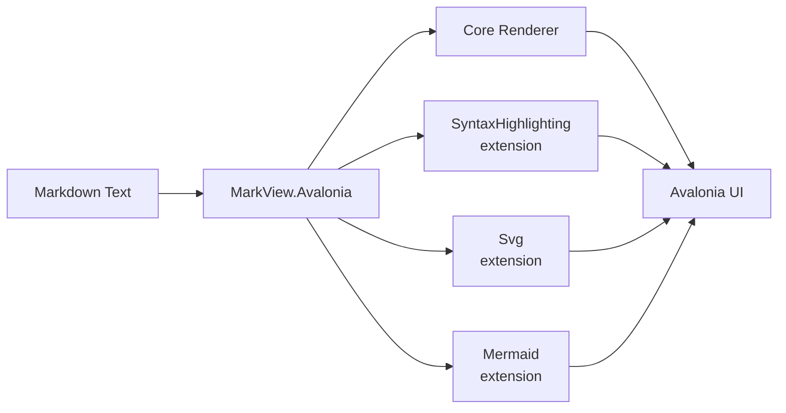

# MarkView.Avalonia Feature Showcase

> Welcome to the **MarkView.Avalonia** feature showcase. This document demonstrates every
> rendering capability supported by the viewer and its extension packages.
> Press **Ctrl+F** to find text in it with the find box above.

## Table of Contents

- [Headings](#headings)
- [Text Formatting](#text-formatting)
- [Emphasis Extras](#emphasis-extras)
- [HTML](#html)
- [Blockquotes](#blockquotes)
- [Task List](#task-list)
- [Tables](#tables)
- [Code Blocks](#code-blocks)
- [Bitmap Image](#bitmap-image)
- [SVG Image](#svg-image)
- [Mermaid Diagram](#mermaid-diagram)
- [Math](#math)
- [Custom Fenced Blocks](#custom-fenced-blocks)

---

## Headings

# Heading 1
## Heading 2
### Heading 3
#### Heading 4
##### Heading 5
###### Heading 6

---

## Text Formatting

Regular paragraph with **bold text**, *italic text*, ~~strikethrough~~, and `inline code`.

You can also combine them: ***bold and italic***, **`bold code`**, *~~italic strikethrough~~*.

---

## Emphasis Extras

The `EmphasisExtras` Markdig extension unlocks four additional inline styles:

| Syntax     | Result        | Description |
|------------|---------------|-------------|
| `~text~`   | H~2~O         | Subscript   |
| `^text^`   | x^2^ + y^2^ = r^2^ | Superscript |
| `++text++` | ++inserted++  | Underline (inserted) |
| `==text==` | ==marked==    | Highlighted (marked) |

---

## HTML

GitHub READMEs often use a little HTML. MarkView renders a safe subset of it with native controls
(`UseHtmlSubset()`, part of the default pipeline): nothing runs, and only images are fetched, through the
same loaders as markdown images.

<p align="center">
  <a href="https://avaloniaui.net"></a><br>
  <b>A centered README header</b><br>
  <sub>with a linked logo, sized by its <code>width</code> attribute</sub>
</p>

Press <kbd>Ctrl</kbd>+<kbd>C</kbd> to copy. Water is H<sub>2</sub>O and E = mc<sup>2</sup>.
<mark>Marked</mark>, <ins>inserted</ins>, <del>deleted</del>, <b>bold</b>, <i>italic</i>,
<code>code</code> and <a href="#html" title="Back to this section">a link</a>.

<div align="right">

Markdown inside a `<div align="right">`, separated from its tags by **blank lines**, is aligned too.

</div>

<span>Any other tag, such as this</span> <code>&lt;span&gt;</code>, is dropped and its text shows as it is.

<hr>

## Blockquotes

> This is a top-level blockquote. It can contain *formatted* text and **multiple** lines.
>
> > This is a nested blockquote inside the first one.
> > Nested content can also span multiple lines.
>
> Back to the outer blockquote.

---

## Task List

- [x] Core markdown rendering (headings, paragraphs, lists)
- [x] Syntax-highlighted code blocks via `MarkView.Avalonia.SyntaxHighlighting`
- [x] SVG image rendering via `MarkView.Avalonia.Svg`
- [x] Mermaid diagram rendering via `MarkView.Avalonia.Mermaid`
- [x] LaTeX math rendering via `MarkView.Avalonia.Math`
- [x] Tables, blockquotes, task lists
- [ ] PDF export (planned)

---

## Tables

| Extension Package                      | Feature            | NuGet Status |                Notes |
|:---------------------------------------|:-------------------|:------------:|---------------------:|
| `MarkView.Avalonia`                    | Core rendering     | ✅ Published  |        Markdig-based |
| `MarkView.Avalonia.SyntaxHighlighting` | Code highlighting  | ✅ Published  |    TextMate grammars |
| `MarkView.Avalonia.Svg`                | SVG images         | ✅ Published  |         Avalonia.Svg |
| `MarkView.Avalonia.Mermaid`            | Mermaid diagrams   | ✅ Published  |            Pure .NET |
| `MarkView.Avalonia.Math`               | LaTeX math         | ✅ Published  | CSharpMath.SkiaSharp |

---

## Code Blocks

### C#

```csharp
using MarkView.Avalonia;

var viewer = new MarkdownViewer();
viewer.UseTextMateHighlighting()
      .UseSvg()
      .UseMermaid();

viewer.Markdown = "# Hello, **World**!";
```

### JSON

```json
{
  "name": "MarkView.Avalonia",
  "version": "1.0.0",
  "extensions": [
    "SyntaxHighlighting",
    "Svg",
    "Mermaid"
  ],
  "targetFramework": "net8.0"
}
```

### Python

```python
import base64

svg = '<svg xmlns="http://www.w3.org/2000/svg" width="200" height="120"></svg>'
encoded = base64.b64encode(svg.encode()).decode()
data_uri = f"data:image/svg+xml;base64,{encoded}"
print(data_uri)
```

### A long block

Turn on **Line numbers**, **Wrap code** or **Short code blocks** above to see the code block options.

```csharp
// A long line, which runs past the block unless "Wrap code" is on: var viewer = new MarkdownViewer { ShowCodeBlockLineNumbers = true, WrapCodeBlockLines = true, CodeBlockMaxHeight = 400 };
public static class Fibonacci
{
    public static IEnumerable<long> Sequence()
    {
        long previous = 0, current = 1;
        while (true)
        {
            yield return previous;
            (previous, current) = (current, previous + current);
        }
    }

    public static long Nth(int n) => Sequence().Skip(n).First();

    public static void Main()
    {
        foreach (var number in Sequence().Take(10))
            Console.WriteLine(number);
    }
}
```

---

## Bitmap Image

The images below use relative paths — they resolve against the `BaseUri` that MarkView infers automatically from the `Source` location (here, `avares://MarkView.Avalonia.Demo/Assets/`).

Two equivalent syntaxes are supported for specifying image dimensions:

| Form         | Syntax               | Notes                                                                             |
|--------------|----------------------|-----------------------------------------------------------------------------------|
| Quoted title | `` | Valid CommonMark — portable across renderers (others show the title as a tooltip) |
| Shorthand    | ``   | MarkView-only convenience; preprocessed to the quoted form before parsing         |

The table below shows the same image at different sizes:

| Syntax                   | Result                                             |
|--------------------------|----------------------------------------------------|
| ``   |  40×40 |
| ``   |  80×80 |
| `` |  160×160 |
| `` (no size)  |  natural size   |

Click any image to open it in a lightbox over the viewer; click anywhere or press Esc to close it.

An image that cannot be loaded shows a placeholder with its alt text instead:


---

## SVG Image

The image below is rendered from an inline `data:image/svg+xml;base64` URI using the
`MarkView.Avalonia.Svg` extension:


---

## Mermaid Diagram

The diagram below is rendered live by the `MarkView.Avalonia.Mermaid` extension:



---

## Math

LaTeX math is rendered by the `MarkView.Avalonia.Math` extension, via [CSharpMath](https://github.com/verybadcat/CSharpMath)'s SkiaSharp renderer — pure .NET, no browser or WebView required.

Inline math sits within a sentence, e.g. mass–energy equivalence, $E = mc^2$, or the Pythagorean
theorem, $a^2 + b^2 = c^2$.

Block math renders as its own centred element:

$$
\lim_{n \to \infty} \left(1 + \frac{1}{n}\right)^n = e = \sum_{k=0}^{\infty} \frac{1}{k!}
$$

The LaTeX bracket delimiters that LLMs tend to write work too: the roots of \(ax^2 + bx + c = 0\) are
\[
x = \frac{-b \pm \sqrt{b^2 - 4ac}}{2a}
\]
for any \(a \neq 0\).

---

## Custom Fenced Blocks

An application can render the fenced blocks of a language as its own control, without writing a
Markdig renderer. This demo registers `palette`, which shows a list of colours as swatches:

```palette
#3B82F6 #10B981 #F59E0B #EF4444 #8B5CF6
```

The factory also receives the rest of the info string, so a fence can take arguments. Here
`size=24` makes the swatches smaller:

```palette size=24
#3B82F6 #10B981 #F59E0B #EF4444 #8B5CF6
```

````markdown
```palette
#3B82F6 #10B981 #F59E0B #EF4444 #8B5CF6
```

```palette size=24
#3B82F6 #10B981 #F59E0B #EF4444 #8B5CF6
```
````

## Custom Containers as Controls

Custom containers can render as the application's own control, built around their markdown. This
demo registers `spoiler`, which shows its content in an expander titled by the text after the name:

:::spoiler What does `UseContainerRenderer` give the factory?
The container's blocks, already rendered: **formatting**, [links](https://github.com/Kryptos-FR/MarkView.Avalonia)
and lists work as anywhere else, and so do selection, find and the keyboard.

- Tab reaches the header, then the links inside.
:::

````markdown
:::spoiler What does `UseContainerRenderer` give the factory?
The container's blocks, already rendered: …
:::
````

Other names keep the default look:

:::note A plain container
Styled by its name with `Border.markdown-custom-container.note`.
:::

## Patterns in the Text

An application can turn matches of a regular expression into links or inlines of its own. This demo
links issue numbers such as #138 to this repository's issues, and shows mentions such as @Kryptos-FR
in a style of its own. Code (`#138`) and link text ([#138](https://github.com/Kryptos-FR/MarkView.Avalonia))
are left alone.

```markdown
Issue numbers such as #138, mentions such as @Kryptos-FR.
```

---

*End of showcase.*
