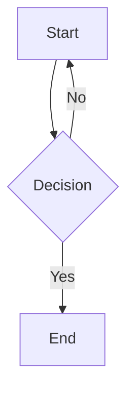

# MarkView.Avalonia.Mermaid

[](https://www.nuget.org/packages/MarkView.Avalonia.Mermaid)
[](https://www.nuget.org/packages/MarkView.Avalonia.Mermaid)
[](https://avaloniaui.net)
[](https://github.com/Kryptos-FR/MarkView.Avalonia/actions/workflows/ci.yml)
[](../../LICENSE.md)

Mermaid diagram rendering extension for [MarkView.Avalonia](https://www.nuget.org/packages/MarkView.Avalonia). Renders fenced `mermaid` code blocks as vector diagrams using [Mermaider](https://github.com/nullean/mermaider) — a pure managed .NET parser and renderer. No browser, no WebView, and no JavaScript runtime required.

## Installation

```bash
dotnet add package MarkView.Avalonia.Mermaid
```

## Quick Start

Call `UseMermaid()` before setting `Markdown`:

```csharp
var viewer = new MarkdownViewer();
viewer.UseMermaid();
viewer.Markdown = markdownText;
```

Or activate globally at application startup:

```csharp
// App.axaml.cs
MarkdownViewerDefaults.Extensions.AddMermaid();
```

Diagrams are written in standard [Mermaid](https://mermaid.js.org) syntax inside a fenced code block:

````markdown

````

## Supported Diagram Types

The extension targets the diagram types supported by the version of Mermaider this package depends on, including common diagrams such as:

- Flowcharts (`graph TD`, `flowchart LR`)
- Sequence diagrams (`sequenceDiagram`)
- Class diagrams (`classDiagram`)
- State diagrams (`stateDiagram-v2`)
- Entity-relationship diagrams (`erDiagram`)
- Gantt charts (`gantt`)
- Pie charts (`pie`)
- Git graphs (`gitGraph`)
- Mind maps (`mindmap`)
- Timeline (`timeline`)

See the [Mermaid documentation](https://mermaid.js.org/intro/) for syntax reference. If a diagram fails to render, the extension falls back to a plain-text block containing the original source. While a document is streaming, a `mermaid` fence at the end of the text is shown as a `mermaid` code block and becomes a diagram once a blank line or another block follows it.

## Theme Awareness

Diagram colours come from `MermaidTheme.axaml`, included the same way as the core package's theme:

```xml
<!-- App.axaml -->
<StyleInclude Source="avares://MarkView.Avalonia.Mermaid/Themes/MermaidTheme.axaml" />
```

It defines Dark/Light `SolidColorBrush` resources you can override in your own styles:

| Resource key | Dark | Light |
|---|---|---|
| `MarkdownMermaidBackground` | `#18181B` | `#FFFFFF` |
| `MarkdownMermaidForeground` | `#FAFAFA` | `#27272A` |
| `MarkdownMermaidAccent` | `#60A5FA` | `#3B82F6` |

If the theme isn't included, the same values are used as a built-in fallback — the extension works standalone.

When the user switches between light and dark, the diagram is automatically re-rendered. The `Border` container stays in place — scroll position is preserved and other document elements are not affected.

## Combining with Syntax Highlighting

When `MarkView.Avalonia.SyntaxHighlighting` is also registered, non-mermaid fenced code blocks in the same document get full syntax highlighting. Registration order does not matter:

```csharp
// Per-instance
viewer
    .UseTextMateHighlighting()
    .UseMermaid();

// Or globally
MarkdownViewerDefaults.Extensions.AddTextMateHighlighting();
MarkdownViewerDefaults.Extensions.AddMermaid();
```

`MermaidBlockRenderer` handles all `FencedCodeBlock` nodes. Mermaid blocks are rendered as diagrams; all other fenced blocks are rendered as styled code blocks using any `ICodeHighlighter` registered by the SyntaxHighlighting extension.

## How It Works

`UseMermaid()` registers a `MermaidExtension` which inserts `MermaidBlockRenderer` immediately before the first renderer that already accepts a `FencedCodeBlock` (not always at index 0 — this keeps registration order-independent when a sibling extension such as `MarkView.Avalonia.Math` is also registered), so it intercepts every `FencedCodeBlock` before the default `CodeBlockRenderer`.

For mermaid blocks:
1. Source lines are extracted from the fenced block. The diagram itself is rendered the first time it comes within a screen of the viewport, so diagrams further down a long document cost nothing while it loads.
2. `MermaidRenderer.RenderSvg` produces an SVG string whose colours and font sizes use CSS custom properties and `color-mix()`.
3. These expressions (`var(--_text)`, `color-mix(in srgb, var(--fg) 10%, var(--bg))`, `var(--fs-s)` etc.) are resolved from the properties the SVG declares and replaced with hex colours and pixel sizes, so SkiaSharp, which ignores them, can render the diagram.
4. The SVG is loaded into an `SvgImage` and displayed in an `Image` control. Labels are drawn in the document's font as Avalonia resolves it (the viewer's inherited `FontFamily`, e.g. Inter with `WithInterFont()`), wherever the SVG asks for that font by name. In the browser, where SkiaSharp itself only has a monospace fallback font, every label uses the document's font.
5. `MaxWidth` is constrained to the `ScrollViewer` viewport and updated on resize.

For non-mermaid blocks, rendering is delegated to the standard code block path (colours are updated in place on a theme switch when the registered highlighter is an `IThemeAwareCodeHighlighter` or `IDualThemeCodeHighlighter`).

## License

[MIT](../../LICENSE.md) © Nicolas Musset
