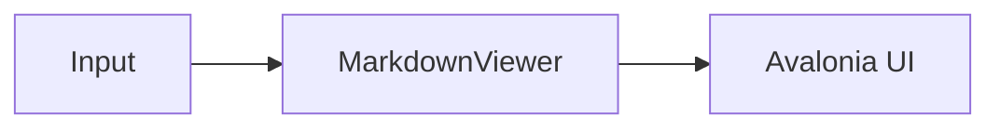

# MarkView.Avalonia.Mermaid

[](https://www.nuget.org/packages/MarkView.Avalonia.Mermaid)
[](https://www.nuget.org/packages/MarkView.Avalonia.Mermaid)
[](https://avaloniaui.net)
[](https://github.com/Kryptos-FR/MarkView.Avalonia/actions/workflows/ci.yml)
[](https://github.com/Kryptos-FR/MarkView.Avalonia/blob/main/LICENSE.md)

[Mermaid](https://mermaid.js.org) diagrams for [MarkView.Avalonia](https://www.nuget.org/packages/MarkView.Avalonia), drawn with [Mermaider](https://github.com/nullean/mermaider) in .NET: no browser, WebView or JavaScript.

## Installation

```bash
dotnet add package MarkView.Avalonia.Mermaid
```

## Usage

```csharp
viewer.UseMermaid();                          // MermaidStyle.Quiet
viewer.UseMermaid(MermaidStyle.Blueprint);    // or Tonal

// every viewer of the application, at startup
MarkdownViewerDefaults.Extensions.AddMermaid();
```

Include the package's theme in `App.axaml` to give diagrams the colours you choose (without it, the default colours are used):

```xml
<StyleInclude Source="avares://MarkView.Avalonia.Mermaid/Themes/MermaidTheme.axaml" />
```

Write diagrams in fenced `mermaid` blocks:

````markdown

````

Flowcharts, sequence, class, state and entity-relationship diagrams, Gantt and pie charts, git graphs, mind maps and timelines are supported. Diagrams are drawn again in place when the theme switches between light and dark, open in the viewer's lightbox when `IsImageZoomEnabled` is on, and can be saved as SVG or PNG.

## Documentation

- [Mermaid diagrams](https://kryptos-fr.github.io/MarkView.Avalonia/guides/images/#mermaid-diagrams): styles, colours, fonts and when diagrams render.
- [Lightbox](https://kryptos-fr.github.io/MarkView.Avalonia/guides/images/#lightbox) and [Saving images and diagrams](https://kryptos-fr.github.io/MarkView.Avalonia/guides/images/#saving-images-and-diagrams).
- [Resource keys](https://kryptos-fr.github.io/MarkView.Avalonia/reference/resource-keys/): the diagram colours you can redefine.

The [documentation site](https://kryptos-fr.github.io/MarkView.Avalonia/) covers the whole library, and the [demo](https://kryptos-fr.github.io/MarkView.Avalonia/demo/) shows every feature in the browser.

## License

[MIT](https://github.com/Kryptos-FR/MarkView.Avalonia/blob/main/LICENSE.md) © Nicolas Musset
